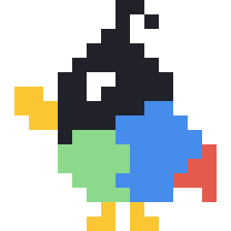

<p align="center"></p>
<h1 align="center">Chatot</h1>

[中文说明](README.zh-CN.md)

Select → right-click → **Translate with Chatot**. A macOS menubar app that translates selected text or images in any app, including the Claude Code terminal, Chrome and native apps, into a floating panel next to your cursor. Built for one workflow: keep your agent conversation in English for quality, read the parts you care about in Chinese.

- **Terminal (Claude Code in VS Code / Cursor):** select output, right-click → Translate with Chatot.
- **Chrome:** right-click selected text or an image → Translate with Chatot.
- **Native apps (Safari, Preview, Notes, PDF viewers):** right-click → Services → Translate with Chatot.
- **Screenshots:** after ⇧⌘4 or ⇧⌘3, a card offers to translate the screenshot.
- Floating panel placed off the selection, grows as the translation streams; text is selectable, ⌘C works, Original toggle, Copy, Close.
- Long text is split into paragraphs and translated in parallel; every chunk is checked (echo, length, Chinese ratio) and retried. Tables and code blocks pass through untouched. Optional glossary.
- English → Simplified Chinese by default (dropdown); Chinese source text is translated to English.
- Providers: **Claude Haiku 5.5** (default, via your Anthropic API key; the Max plan includes monthly API credits), or ChatGPT / DeepSeek with their own keys. API keys only, never web sessions.
- UI in English or 中文. Menubar: Pause / Settings / Quit.

Cost: about $0.002 for an 855-word text with Haiku; a short paragraph is a fraction of a cent and shows its first words in ~0.5 s.

## Install (release build)

1. Download `Chatot-<version>.zip` from [Releases](https://github.com/ziangit/chatot/releases), unzip, move `Chatot.app` to `/Applications`.
2. The app is not notarized. Clear the quarantine flag once, or right-click → Open:
   ```
   xattr -dr com.apple.quarantine /Applications/Chatot.app
   ```
3. Open Chatot, click the menubar bird → **Settings…**, paste your API key, **Save to Keychain**. Pick the UI language, target language and model from the dropdowns.
4. Allow access to your Desktop folder when macOS asks (the screenshot watcher reads new screenshots there). No Accessibility or Screen Recording permission is needed.

Right-click → Services → Translate with Chatot now works in native apps. For the terminal and Chrome, continue below.

### Claude Code in VS Code / Cursor (the main use case)

Claude Code captures the mouse by default, so plain drag-select does not work in its terminal UI. Turn that off: add to `~/.zshrc` (or `terminal.integrated.env.osx` in VS Code settings)

```
export CLAUDE_CODE_DISABLE_ALTERNATE_SCREEN=1
```

then open a new terminal and start `claude` again. Selection and wheel-scrolling behave like a normal terminal afterwards.

Install the extension that adds the right-click item (Electron apps do not show the macOS Services menu):

```
code --install-extension chatot-vscode-<version>.vsix      # VS Code
cursor --install-extension chatot-vscode-<version>.vsix    # Cursor
```

The `.vsix` is on the Releases page. Reload the window afterwards.

### Chrome

Download `chatot-chrome-extension-<version>.zip` from Releases, unzip, run `./install.sh` inside it (copies the extension to `~/.config/chatot/chrome-extension` and registers the native-messaging bridge for Chrome, Brave, Edge, Arc and Chromium). Then load it once: `chrome://extensions` → Developer mode → Load unpacked → `~/.config/chatot/chrome-extension`.

## Build from source

Requires macOS 14+ and the Swift toolchain from Xcode Command Line Tools.

```
git clone https://github.com/ziangit/chatot && cd chatot
cp .env.example .env            # optional: put ANTHROPIC_API_KEY here instead of the keychain
./scripts/build-app.sh          # builds, signs, installs /Applications/Chatot.app, registers the Service
./scripts/install-chrome-extension.sh
cd vscode-extension && npx --yes @vscode/vsce package && code --install-extension chatot-vscode-*.vsix
```

`build-app.sh` signs ad hoc unless a code-signing identity named "Chatot Dev" exists in your keychain (a self-signed one keeps the Desktop-folder grant across rebuilds; recipe in `docs/ARCHITECTURE.md`).

## Develop

```
swift build
swift run chatot-cli translate "Some English text"     # end-to-end through the real provider
swift run chatot-cli image path/to/screenshot.png
swift run chatot-tests                                   # unit tests (plain harness; Command Line Tools ship no XCTest)
```

Config: `.env` or `~/.config/chatot/.env` (`ANTHROPIC_API_KEY`, `OPENAI_API_KEY`, `DEEPSEEK_API_KEY`, `CHATOT_PROVIDER`, `CHATOT_TARGET_LANG`, model overrides), or the Settings window. Glossary: `~/.config/chatot/glossary.txt`, one `term = translation` per line. Log: `~/Library/Logs/chatot.log`. URL scheme for other integrations: `chatot://translate?text=…`, `chatot://image?url=…`.

Benchmarks, gotchas and design notes: `docs/ARCHITECTURE.md`. Product scope: `docs/PRODUCT.md`.

## Privacy and policy

Text and images you translate are sent only to the provider you chose, with your own API key. Nothing is logged except timing and the first 40 characters of each request in the local log. Chatot never touches claude.ai or chatgpt.com web sessions or OAuth tokens.

MIT license.
